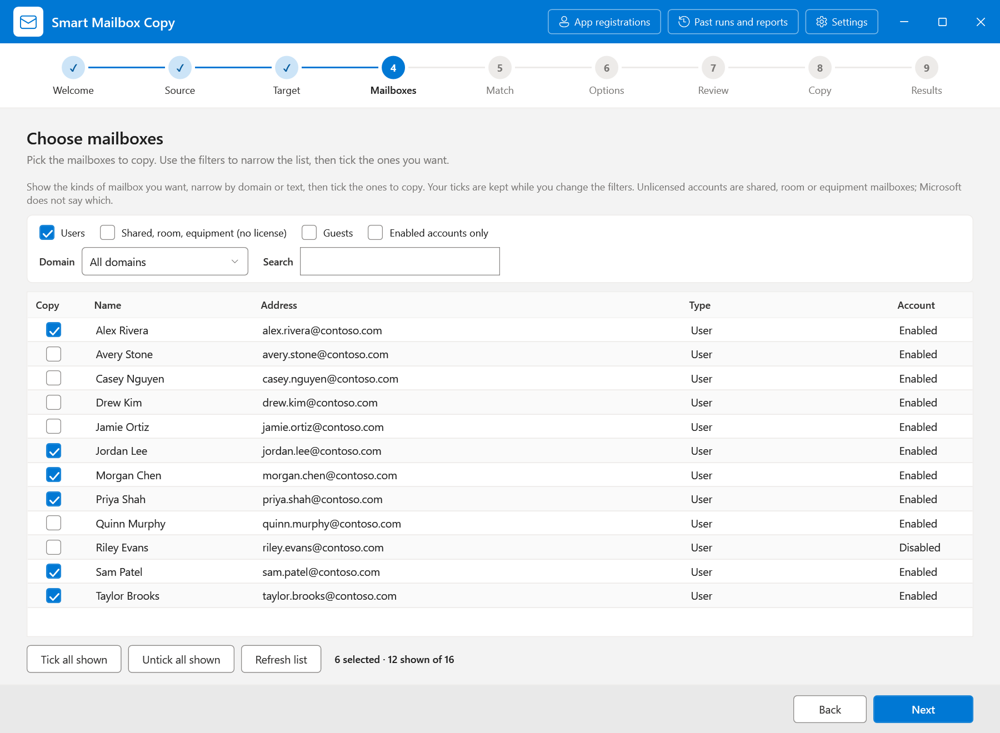
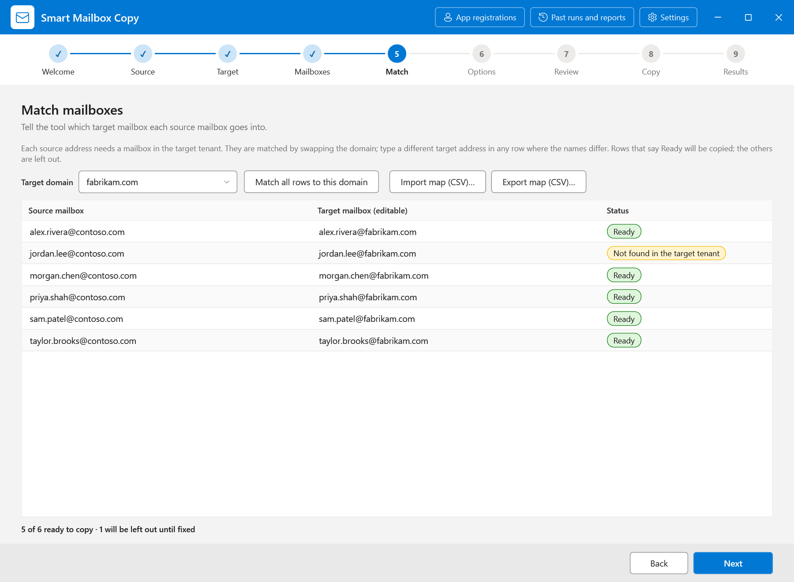
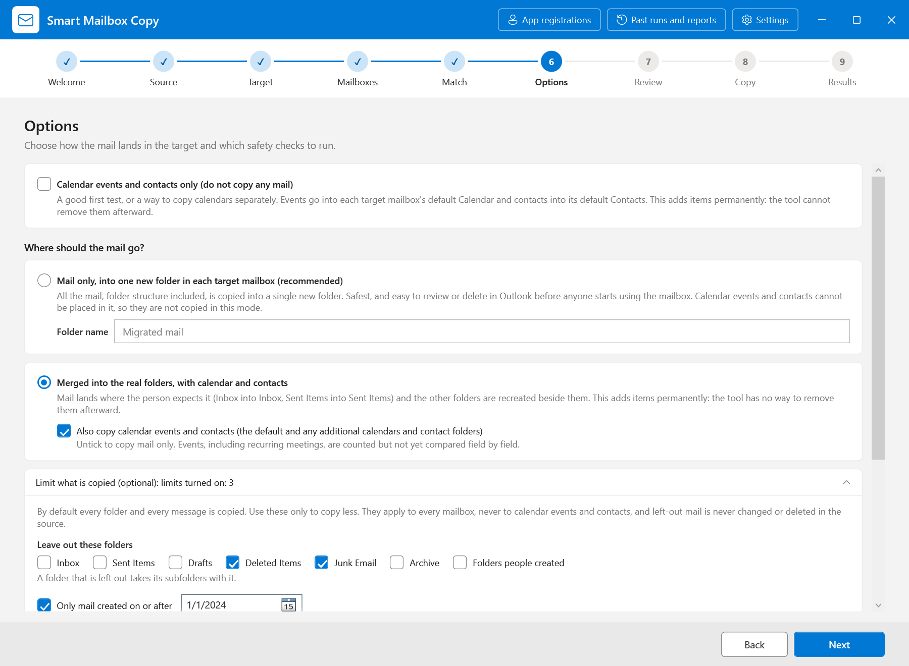
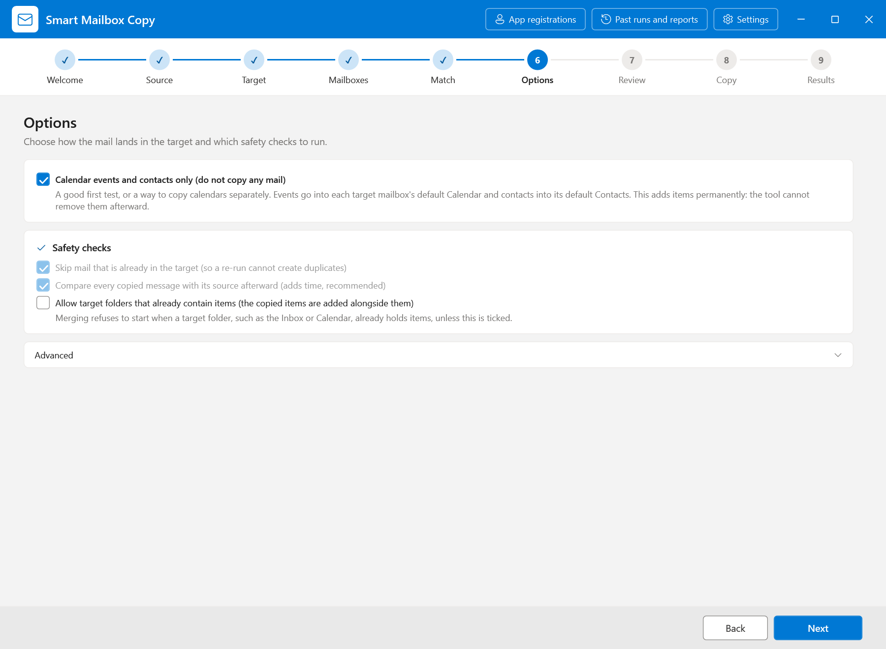
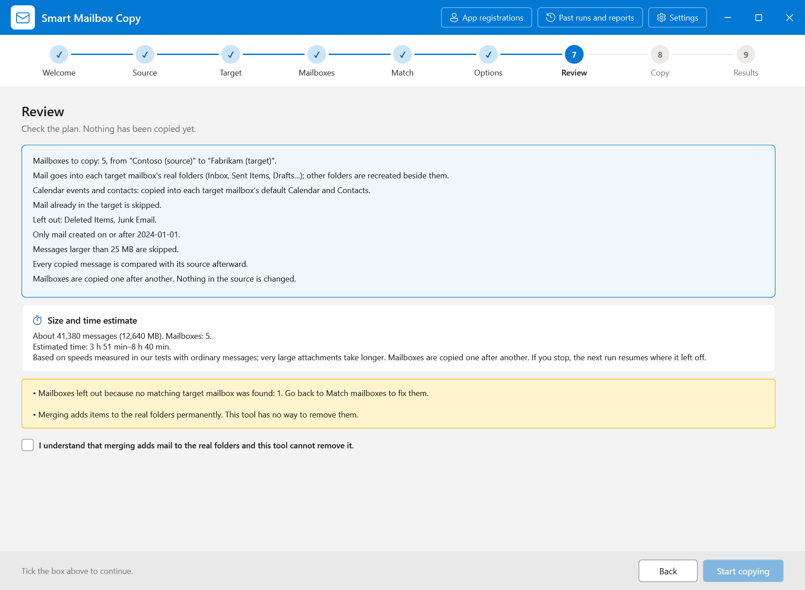
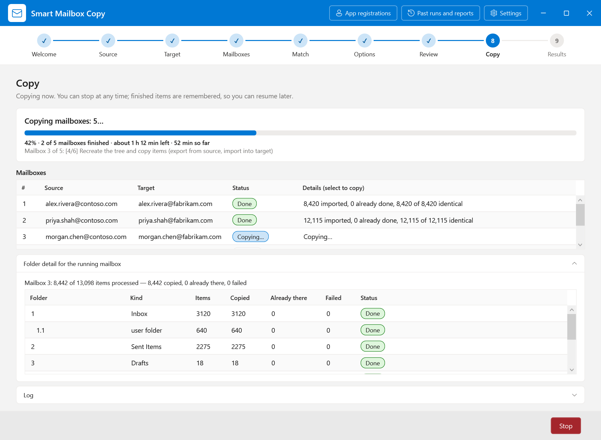
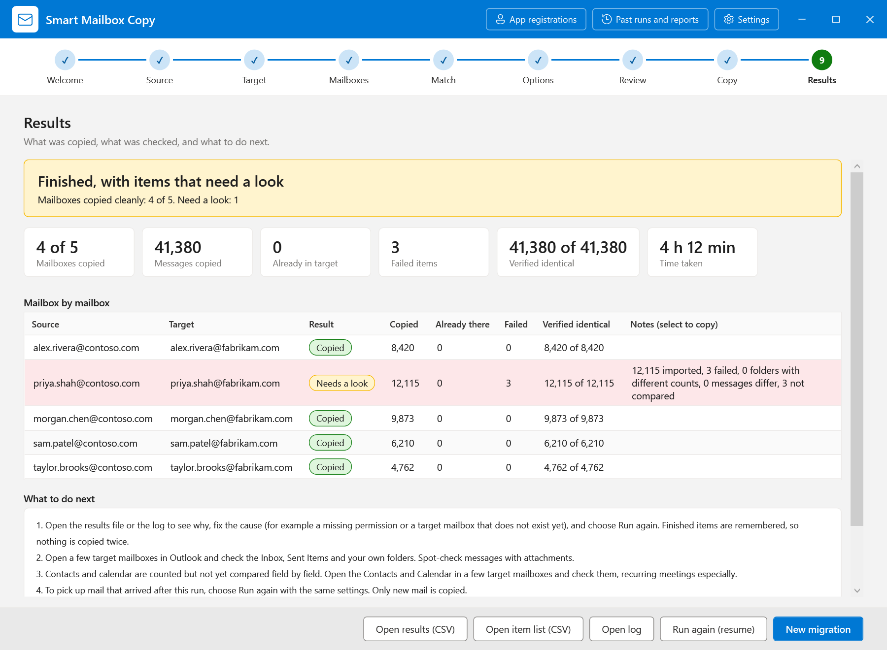
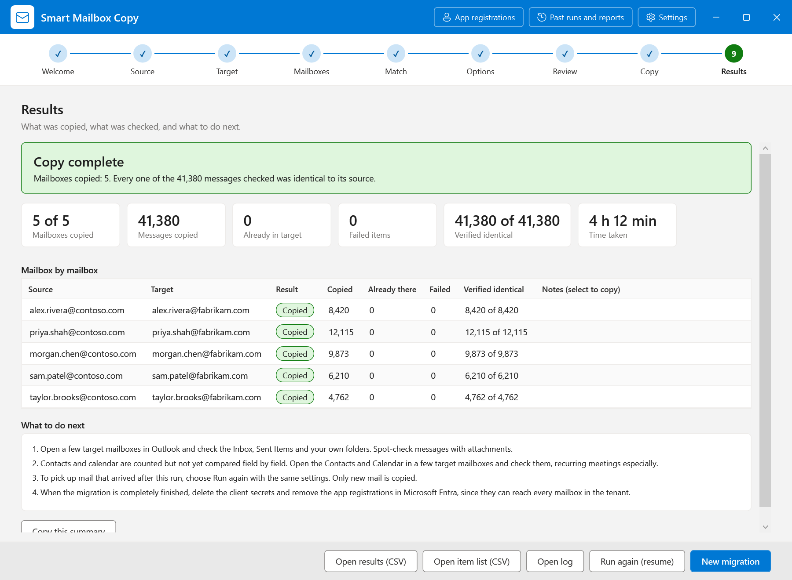
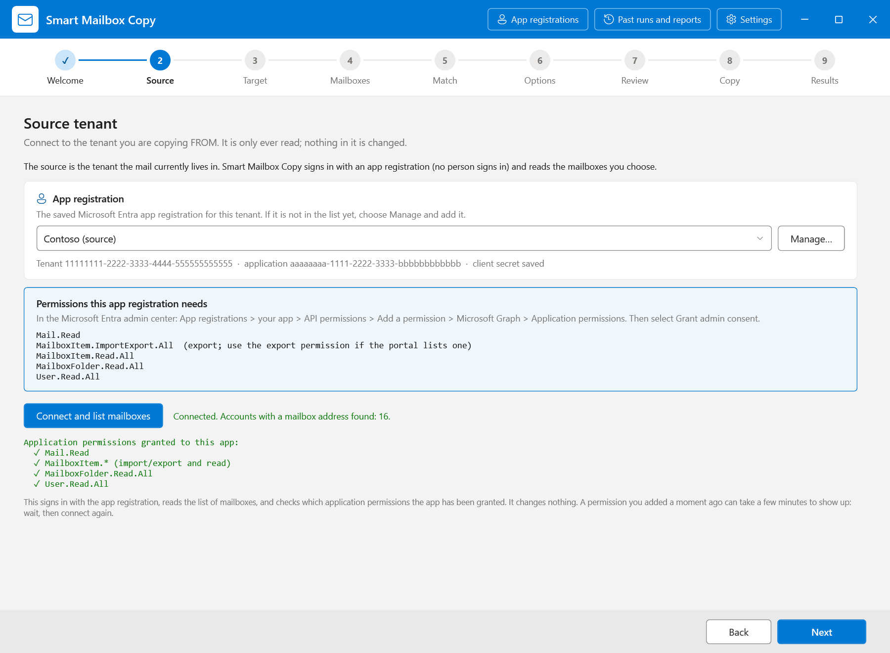
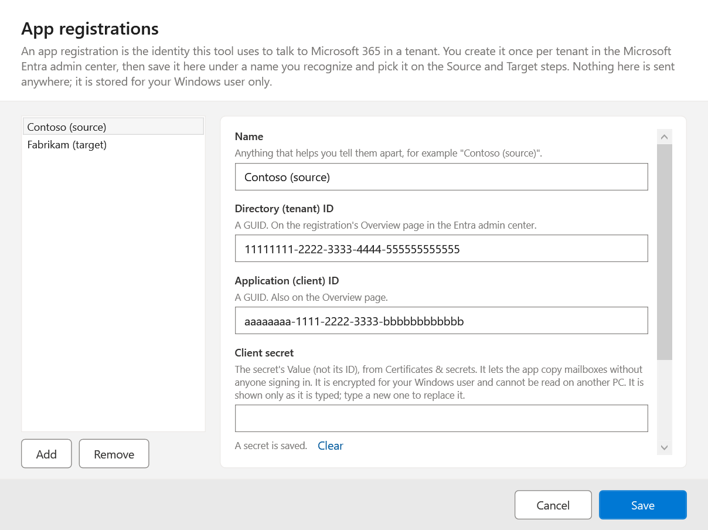

# Smart Mailbox Copy — WPF Desktop App

[](USER-GUIDE.md) [](https://github.com/sregan1/Smart-Mailbox-Copy/releases/latest) [](LICENSE)

A free and open source Windows desktop application for copying Exchange Online mail between mailboxes and tenants — one mailbox, a chosen few, or everyone — with full fidelity and field-by-field verification.

  

---

## Screenshots

| | |
|---|---|
|  |  |
| **Choose mailboxes — filter by kind, domain or text** | **Match mailboxes — domain swap, editable, CSV import and export** |
|  |  |
| **Options — where the mail goes and what to limit** | **Options — calendar events and contacts only** |
|  |  |
| **Review — plan, estimate and warnings** | **Copy — overall progress, time remaining, per-mailbox status** |
|  |  |
| **Results — what needs a look** | **Results — everything copied and verified** |
|  |  |
| **Source tenant — checks the app's granted permissions** | **App registrations — secrets encrypted for your Windows user** |

*The screenshots use fictional data (Contoso and Fabrikam). Start the app with `--demo` to try the screens without a tenant: it makes no network calls and saves nothing.*

---

## Installation (No Build Required)

1. **Download** the latest release from the [Releases page](https://github.com/sregan1/Smart-Mailbox-Copy/releases/latest): a zip with the wizard and the command line, or just the wizard `.exe`. Both are self-contained single-file binaries, no extraction or installer needed.
2. **Register an app in each tenant** (source and target) — follow the [Entra App Registration](#entra-app-registration) steps below.
3. **Launch** `SmartMailboxCopyApp.exe`, choose **App registrations…**, and add one for each tenant (name, tenant ID, application ID, client secret).
4. **Connect and copy** — follow the wizard: connect both tenants, choose mailboxes, match them, choose options, review, and copy.

> **Windows SmartScreen** may show a warning on first launch because the binary is downloaded from the internet. Click **More info → Run anyway**. No .NET runtime installation is required — the runtime is bundled in the executable.

### Build from source

```
dotnet build
dotnet run --project src/SmartMailboxCopy.App
```

```
src/SmartMailboxCopy.Core   copy engine, sign-in, guards, journal, verifier, mailbox directory, batch runner
src/SmartMailboxCopy.App    the Windows wizard (WPF)
src/SmartMailboxCopy.Cli    command-line front end
docs/                       the screenshots used in the user guide
```

---

## Features

A nine-step wizard with a short explanation on every screen:

| Step | What you do |
|---|---|
| **Welcome** | Read what the tool will and will not do |
| **Source tenant / Target tenant** | Pick a saved app registration, connect, and see which permissions it was granted |
| **Choose mailboxes** | List every mailbox in the source tenant; filter by users, shared/room/equipment (unlicensed), guests, enabled accounts, domain or text; tick the ones to copy |
| **Match mailboxes** | Match each source mailbox to a target mailbox (domain swap, editable, CSV import and export); only rows that exist in the target are copied |
| **Options** | Choose where the mail goes, whether to copy calendar events and contacts, and any limits |
| **Review** | See the plan, a size and time estimate, and warnings |
| **Copy** | Watch overall progress with time remaining; stop and resume at any time |
| **Results** | Totals, a mailbox-by-mailbox table, what to do next, and CSV exports |

**Where the mail goes:**

| Mode | What it does |
|---|---|
| **Mail only, into one new folder** *(recommended)* | Everything lands in a single new folder in each target mailbox, folder structure included. Easy to review or delete in Outlook |
| **Merged into the real folders** | Inbox into Inbox, Sent Items into Sent Items and so on, with other folders recreated beside them. Adds items permanently: the tool cannot remove them |

**All modes:**
- **Calendar events and contacts** — the default Calendar and Contacts, plus any additional calendars and contact folders (recreated in the target by name, reused if one already exists; specific ones such as a subscribed holiday calendar can be left out by name). In the merge mode, or on their own with *Calendar events and contacts only*. Tasks, notes and journal cannot be created through Graph and are not copied
- **Limit what is copied (optional)** — leave out folders (with their subfolders), copy only mail created on or after a date, or skip messages over a size. Everything is copied unless you say otherwise
- **Duplicate-safe re-runs** — mail already in the target (same internet message id) is skipped, and a resume journal remembers finished items, so an interrupted copy continues where it left off
- **Field-by-field verification** — every copied message can be compared with its source afterward: dates, read state, flags, categories, importance, attachments, recipients and more
- **Size and time estimate** before you start, an overall progress bar with time remaining while it runs, and a **Stop** button
- **Results screen** with a results CSV, a per-item list (copied, skipped, failed, by item id), and the full log. Notes can be selected and copied
- **Looks like the rest of the Smart Copy family** — a blue app bar, a step bar across the top, and light and dark themes. **Settings** in the app bar also switches the display language: 30 languages, including right-to-left layout for Arabic and Hebrew. The translations are machine-assisted and not yet reviewed by native speakers; logs and CSV files stay in English
- **Saved app registrations** with each client secret encrypted for your Windows user (DPAPI), and a permission check that shows ✓ or ✗ for every permission the app needs
- **Command line** for scripting: `copy`, `copy-tree`, `list-mailboxes` and `copy-batch`. Run it with no arguments for all options

**Not covered by this tool:** in-place archive, group and public-folder mailboxes (not in Microsoft's general release of the API yet), tasks, notes and journal folders, and Exchange settings such as mail rules and mailbox permissions. The [user guide](USER-GUIDE.md#12-other-things-to-migrate) has a checklist for moving those separately.

---

## Prerequisites

| Requirement | Detail |
|---|---|
| **OS** | Windows 10 or 11 (x64) |
| **.NET** | Nothing to install for the release download (the runtime is bundled). To build from source: the .NET 10 SDK |
| **Microsoft 365** | Exchange Online mailboxes in the source tenant, and **existing, licensed mailboxes** in the target tenant to copy into |
| **Entra ID** | An app registration in each tenant with **application** permissions and admin consent (see below), and a client secret. A global administrator sets this up once |
| **Cost** | Microsoft does not list these APIs as metered at the time of writing. The metered-API overview describes a "high-capacity" category that might be, so check Microsoft's current terms before relying on that |

---

## Entra App Registration

The wizard signs in with an **app registration** in each tenant, not as a person, so it can reach other people's mailboxes without their passwords. You need one in the source tenant and one in the target tenant (one can serve both if they are the same tenant).

> **Application permissions apply to every mailbox in the tenant** unless an Exchange administrator restricts them. Create registrations just for this migration, keep their secrets private, and **delete them when you are finished**.

### 1. Register the app

1. Go to [Entra ID](https://entra.microsoft.com) → **App registrations** → **New registration**
2. Name: `Smart Mailbox Copy (source)` or `(target)`
3. Supported account types: **Single tenant** (your org only)
4. No redirect URI is needed
5. Click **Register**
6. Copy the **Application (client) ID** and **Directory (tenant) ID** — you will enter these in the app's **App registrations** dialog

### 2. Add API permissions

Go to **API permissions** → **Add a permission** → **Microsoft Graph** → **Application permissions**, and add:

| Registration | Application permissions |
|---|---|
| **Source** (read and export only) | `Mail.Read`, `MailboxItem.ImportExport.All` (export), `MailboxItem.Read.All`, `MailboxFolder.Read.All`, `User.Read.All` |
| **Target** (import only) | `Mail.ReadWrite`, `MailboxItem.ImportExport.All`, `MailboxItem.Read.All`, `MailboxFolder.Read.All`, `User.Read.All` |

#### Which permissions does each feature need?

| Feature | Extra permission |
|---|---|
| Mail (all modes), and calendar events and contacts in the **default** Calendar and Contacts | None beyond the table above |
| **Additional calendars** in the target | `Calendars.ReadWrite` on the target registration |
| **Additional contact folders** in the target | `Contacts.ReadWrite` on the target registration |

Nothing in the source is ever changed or deleted, and the tool never deletes from the target either.

### 3. Grant admin consent

Click **Grant admin consent for [organization]** on the API permissions page. Each permission should show a green **Granted for [tenant]** status. A permission added later needs consent granted again, and can take a few minutes to appear.

### 4. Create a client secret

Open **Certificates & secrets** → **New client secret**. Copy the secret's **Value** immediately; Microsoft shows it only once. (Do not copy the *Secret ID*; that is a different string and will be rejected.)

### 5. Save it in the app

Open **App registrations…** in the wizard, choose **Add**, and enter the name, tenant ID, client ID and secret. On the Source and Target steps, **Connect and list mailboxes** signs in, lists the tenant's mailboxes, and checks that the app was actually granted each permission.

---

## Configuration

- **App registrations** — saved per Windows user in `%APPDATA%\SmartMailboxCopy\registrations.json`. Each client secret is encrypted for your Windows user and cannot be read on another PC or account. Secrets never appear in logs or reports.
- **Everything else** — chosen in the wizard each run. The last container folder name and your *never write to* list are remembered.
- **Run files** — under `%LOCALAPPDATA%\SmartMailboxCopy`: `logs\` (full log, errors-only log, and a per-item CSV), `reports\` (a readable summary and a per-mailbox results CSV) and `journals\` (the resume journal). The logs and the item list never contain subjects, sender names, folder names or attachment names, only opaque ids and folder positions.
- **Command line** — reads `smartmailboxcopy.config.json` (copy `smartmailboxcopy.config.sample.json` and fill it in; it holds secrets and is ignored by git). Example:

```
dotnet run --project src/SmartMailboxCopy.Cli -- list-mailboxes --side source --app-only
dotnet run --project src/SmartMailboxCopy.Cli -- copy-batch --map map.csv --target-container "Migrated mail" --app-only
```

The command line can also copy a single mailbox with an **interactive sign-in** (delegated permissions), which only reaches the signed-in person's own mailbox. See [the user guide](USER-GUIDE.md#9-command-line).

---

## Copy Modes — Quick Reference

| | New folder | Merged |
|---|---|---|
| Where mail goes | One new folder you name | The real Inbox, Sent Items, Drafts, Deleted Items, Junk Email and Archive; other folders recreated beside them |
| Calendar and contacts | Not copied | Optional (on by default) |
| Existing mail in the target | Untouched | Untouched; copied mail is added alongside |
| Undo | Delete the folder in Outlook | Not possible with this tool |
| Refuses a non-empty target? | No | Yes, unless **Allow target folders that already contain items** is ticked |

See the [user guide](USER-GUIDE.md#6-copy-modes--detailed-reference) for filters, calendar and contacts, the duplicate check and verification in detail.

### Safety rules the code enforces

- Every request is checked against a guard before it is sent. The source side is read-only (plus the export call, which only reads); the target side may only create folders under the destination, create an import session, and read back what the run created. It never deletes.
- A target on the *never write to* list is refused.
- Logs and reports hide addresses and secrets and never print subjects, sender names, folder names or attachment names.

---

---

## Troubleshooting

**"The client secret is not valid" (AADSTS7000215)**
You saved the secret's **ID** instead of its **Value**, or it belongs to a different app. Create a new secret and save its Value under **App registrations**.

**"The client secret has expired"**
Create a new secret in Entra and update it under **App registrations**.

**"That application (client) ID was not found in this tenant"**
The tenant ID and client ID do not belong together. Check both on the registration's Overview page.

**A ✗ next to a permission on the Source or Target step**
That application permission was not granted, or admin consent is missing. Add it under API permissions as an **Application** permission (not Delegated), select **Grant admin consent**, wait a few minutes, and connect again.

**"Access is denied" when the copy starts (HTTP 403)**
A needed application permission is missing or not consented. The target needs `Mail.ReadWrite` and the import/export and read permissions above; additional calendars and contact folders also need `Calendars.ReadWrite` and `Contacts.ReadWrite`.

**"Not found in the target tenant" in the Match step**
The target mailbox does not exist or has no mailbox address yet. Create or license it, reconnect on the Target step to reload the list, or type the right address.

**"These target folders already hold mail"**
Merging into a non-empty folder is refused by default. Tick **Allow target folders that already contain items** if that is what you want.

**A re-run copies nothing**
The journal and the duplicate check found everything already copied. That is the intended behavior. If you emptied the target on purpose, tick **Start over** under Advanced.

**"HTTP 429 / waiting, then retrying" in the log**
Microsoft is throttling. The tool waits and retries automatically; large copies may simply take longer.

**A mailbox shows "Needs a look"**
Open the **Notes** column on the Results screen and the item list for the failed item ids. Fix the cause and run again; finished items are not copied twice.

---

## Key Dependencies

| Package | Version | Purpose |
|---------|---------|---------|
| `Microsoft.Identity.Client` | 4.x | MSAL — application (client credentials) token acquisition, and interactive sign-in for the command line |

Microsoft Graph is called directly over HTTPS; there is no Graph SDK dependency. The wizard uses WPF and the .NET data-protection APIs (DPAPI) that ship with .NET.

---

## About

Originally created and released in November 2026 by Sean Regan.

This is the first release. Please [report issues](https://github.com/sregan1/Smart-Mailbox-Copy/issues); attaching the errors log from `%LOCALAPPDATA%\SmartMailboxCopy\logs` helps, and it contains no mail content.

Copyright (c) 2026 Vivity, Inc.

## Disclaimer

This software is provided "as is", without warranty of any kind, under the terms of the MIT License. To the extent permitted by law, Vivity, Inc. and the authors are not liable for any loss or damage arising from its use. Copying mail between mailboxes and tenants can miss content, and the merge mode adds items that this tool cannot remove: verify the results (the field-by-field comparison helps) before you rely on a copy or retire a source. Application permissions can reach every mailbox in a tenant: protect the client secrets and delete the app registrations when the migration is finished. This project is not affiliated with or endorsed by Microsoft. Microsoft 365, Exchange Online and Microsoft Entra are trademarks of Microsoft Corporation.

## License

[MIT](LICENSE) © 2026 Vivity, Inc.
