# Smart Mailbox Copy — User Guide

*Copy Exchange Online mail between mailboxes and tenants*

**Version 1.1.0  ·  November 2026**

---

## Table of Contents

1. [Overview](#1-overview)
2. [Security](#2-security)
3. [System Requirements](#3-system-requirements)
4. [Setup — Entra App Registration](#4-setup--entra-app-registration)
5. [Step-by-Step Guide](#5-step-by-step-guide)
6. [Copy Modes — Detailed Reference](#6-copy-modes--detailed-reference)
7. [Results, Logs and Files](#7-results-logs-and-files)
8. [Running Again and Resuming](#8-running-again-and-resuming)
9. [Command Line](#9-command-line)
10. [Troubleshooting](#10-troubleshooting)
11. [Test Results](#11-test-results)
12. [Other Things to Migrate](#12-other-things-to-migrate)

---

## 1. Overview

Smart Mailbox Copy is a Windows desktop application that copies mail between Microsoft 365 (Exchange Online) mailboxes, in the same tenant or across tenants. You can move one mailbox, a chosen few, or everyone. It uses Microsoft Graph's mailbox import/export API, so copied messages keep their dates, read state, flags, categories, attachments and the genuine draft state. Afterward it can compare every copied message with its original, field by field.

A guided wizard takes you through nine steps, with a short explanation on every screen:

| # | Step | What you do |
|---|------|-------------|
| 1 | Welcome | Read what the tool will and will not do |
| 2 | Source tenant | Connect to the tenant you are copying **from** |
| 3 | Target tenant | Connect to the tenant you are copying **to** |
| 4 | Choose mailboxes | Pick the mailboxes to copy, with filters |
| 5 | Match mailboxes | Say which target mailbox each source mailbox goes into |
| 6 | Options | Choose where the mail lands, what else to copy, and any limits |
| 7 | Review | Check the plan, the size and the time estimate |
| 8 | Copy | Watch it run; stop and resume whenever you like |
| 9 | Results | See what was copied and checked, and what to do next |

### Key Capabilities

- **One mailbox, a chosen few, or a whole tenant** — with filters for users, shared/room/equipment (unlicensed) mailboxes, guests, enabled accounts, domain and text
- **Two ways to land the mail** — **into one new folder** in each target mailbox (safest), or **merged into the real folders** (Inbox into Inbox, and so on)
- **Calendar events and contacts** — the default Calendar and Contacts, plus additional calendars and contact folders, in the merge option or on their own
- **Optional limits** — leave out folders, copy only mail from a date onward, skip very large messages
- **Duplicate-safe re-runs** — mail already in the target is skipped, so a run can be repeated safely
- **Field-by-field verification** — every copied message can be compared with its source afterward
- **Size and time estimate** before you start, and a progress bar with time remaining while it runs
- **Results screen** with totals, a mailbox-by-mailbox table, and exports (results CSV, a per-item list, the full log)
- **Read-only source** — the source is only ever read. The tool never deletes anything, anywhere

---

## 2. Security

### No Sign-In as Each Person

The tool signs in with an **app registration** in each tenant, using a client secret. That is how it can reach other people's mailboxes without their passwords.

### Powerful by Design — Your Own App Registration

An app registration with these permissions can reach **every mailbox in its tenant** unless an Exchange administrator restricts it. Create registrations just for this migration, keep their secrets private, and **delete them when you are finished**.

> **Important:** Application permissions are tenant-wide. Treat the client secret like a password for every mailbox in the tenant.

### Secrets Stay on Your PC

Each client secret is encrypted for your Windows user (DPAPI) and stored in `%APPDATA%\SmartMailboxCopy\registrations.json`. It cannot be read on another PC or by another Windows user. Secrets never appear in the logs or reports.

### The Source Is Read-Only

Every request is checked by a guard before it is sent. On the source side only reads (and the export call, which only reads) are allowed.

### The Target Only Receives

The tool can create folders under the destination, create an import session, and read back what it created. It has no delete.

### Logs Contain No Mail Content

Logs and reports hide addresses and secrets and never show subjects, sender names, folder names or attachment names. The per-item list holds opaque item ids and folder positions only.

### No External Servers or Telemetry

Mail travels from the source tenant to your computer and on to the target tenant. Nothing goes to any other service.

---

## 3. System Requirements

| Requirement | Detail |
|---|---|
| **OS** | Windows 10 or 11 (64-bit) |
| **Installation** | None needed with the release download: the wizard is a single self-contained `.exe` |
| **Administrator** | A **global administrator** (or someone who can grant admin consent) in each tenant, to set up the app registrations once |
| **Network** | Internet access to Microsoft 365 from the computer that runs the copy. Keep the computer awake and connected for the whole run |
| **Target mailboxes** | They must already exist, with licenses, before you copy into them |

---

## 4. Setup — Entra App Registration

You need **one app registration in each tenant** (source and target). If both are the same tenant, one registration can serve both.

### Step 1 — Create the App Registration

1. Open the **Microsoft Entra admin center** → **App registrations** → **New registration**.
2. Give it a name such as *Smart Mailbox Copy (source)*. Choose **Accounts in this organizational directory only**. Select **Register**.
3. On the **Overview** page, copy the **Directory (tenant) ID** and the **Application (client) ID**. You will need both.

### Step 2 — Add API Permissions

Open **API permissions** → **Add a permission** → **Microsoft Graph** → **Application permissions**, add the permissions below, then select **Grant admin consent**.

| Registration | Application permissions |
|---|---|
| **Source** (read and export only) | `Mail.Read`, `MailboxItem.ImportExport.All` (export), `MailboxItem.Read.All`, `MailboxFolder.Read.All`, `User.Read.All` |
| **Target** (import only) | `Mail.ReadWrite`, `MailboxItem.ImportExport.All`, `MailboxItem.Read.All`, `MailboxFolder.Read.All`, `User.Read.All` |

> **Optional — only for additional calendars and contact folders:** to copy a person's additional calendars and contact folders, also add `Calendars.ReadWrite` and `Contacts.ReadWrite` as **Application** permissions on the **target** registration.

Make sure each shows **Granted for your organization** with a green check. If you choose *Delegated* instead of *Application* by mistake, the copy will be refused.

> **Important — admin consent is per-tenant:** Consenting in one Microsoft 365 tenant has no effect on any other tenant. Repeat the setup, including a fresh admin consent, in each tenant.

### Step 3 — Create a Client Secret

Open **Certificates & secrets** → **New client secret**. Copy the secret's **Value** immediately; Microsoft shows it only once. (Do not copy the *Secret ID*; that is a different string and will be rejected.)

### Step 4 — Save the Registration in the App

Open **App registrations…** at the bottom left of the wizard, choose **Add**, and fill in a name, the tenant ID, the client ID and the client secret. Save.

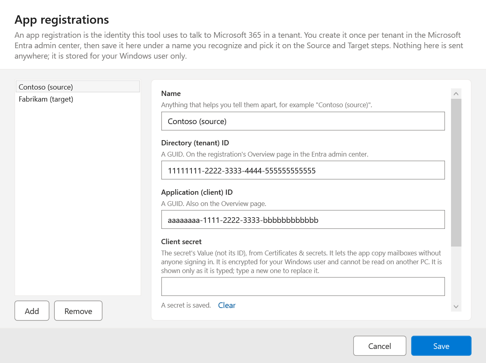

*App registrations dialog — saved registrations, with each client secret encrypted for your Windows user*

> **Note:** The same dialog is available from the **Manage…** button on the Source and Target steps.

### Language and Theme

Select **Settings** in the blue bar at the top to choose the display language (30 languages; the default follows your Windows display language) and the theme (light, dark, or the same as Windows). A theme applies at once; a new language applies the next time you start the app. The translations were produced with machine assistance and have not been reviewed by native speakers, so please report wording that reads wrongly. Log files, the results CSV files and the messages the copy engine writes for each mailbox stay in English.

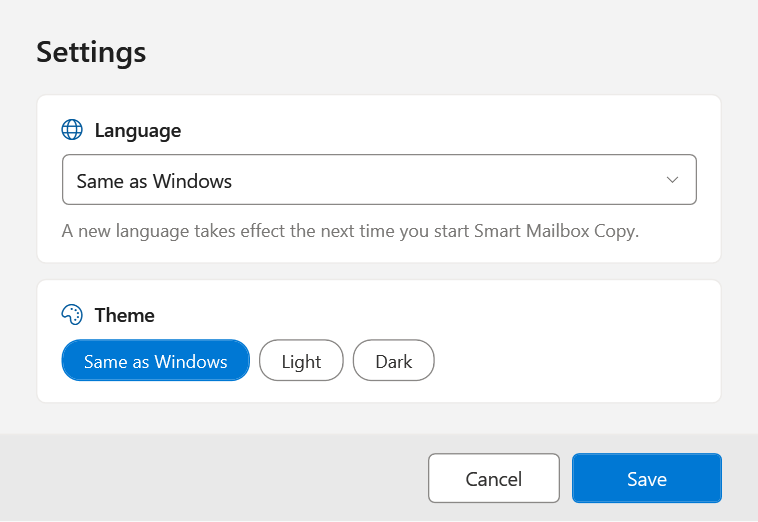

---

## 5. Step-by-Step Guide

Smart Mailbox Copy guides you through a nine-step wizard. The step bar across the top shows your position, and you can return to any finished step at any time before a copy starts: select it in the bar.

> **Note:** The screenshots use fictional data (Contoso as the source tenant, Fabrikam as the target). To try the screens without a tenant, start the app with `SmartMailboxCopyApp.exe --demo`. Demo mode makes no network calls and saves nothing.

### Step 1 — Welcome

A summary of what the tool will and will not do and what you need before you start.

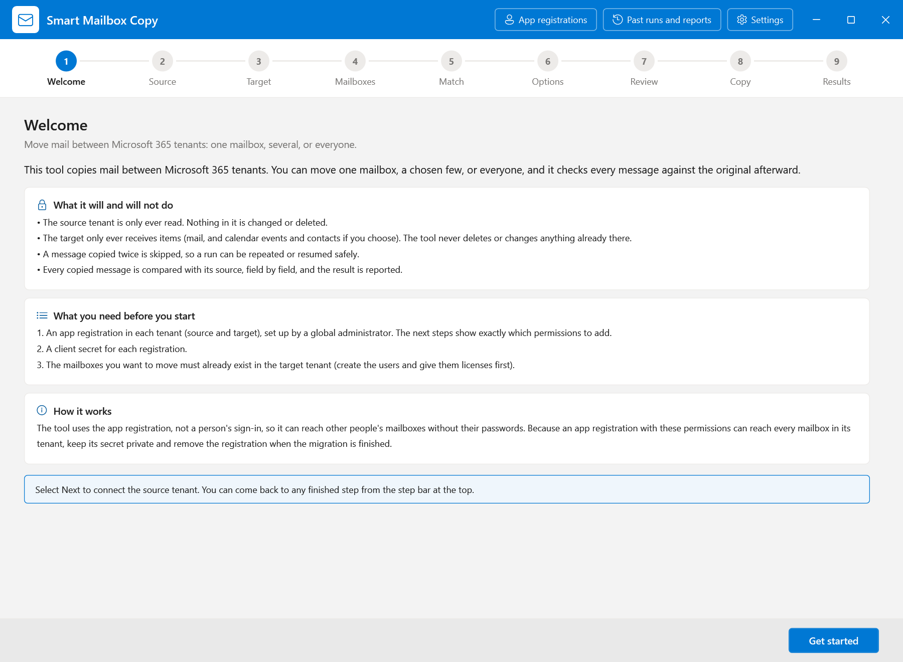

*Step 1 — Welcome*

Click **Get started** to proceed.

### Step 2 — Source Tenant

Choose the app registration for the tenant you are copying **from**, then select **Connect and list mailboxes**. The tool signs in with the registration (no browser window) and reads the list of mailboxes.

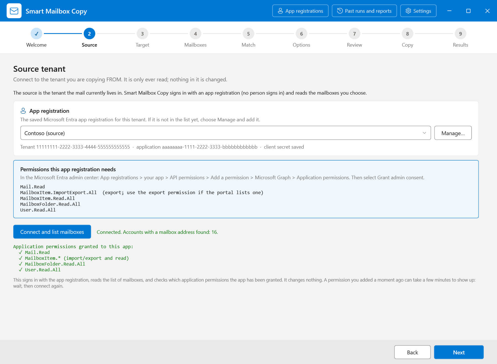

*Step 2 — Source tenant, connected, with the permission check*

The panel lists the exact permissions the registration needs. After connecting it also checks which **application permissions the app has actually been granted**, with a ✓ or ✗ for each (permissions that are only needed for additional calendars and contact folders show a dash if missing). A permission you added a moment ago can take a few minutes to appear; wait and connect again. If the connection fails, the message says why; see [Troubleshooting](#10-troubleshooting).

Click **Next** once it connects.

### Step 3 — Target Tenant

The same, for the tenant you are copying **to**. The mailboxes you want to copy into must already exist in the target tenant.

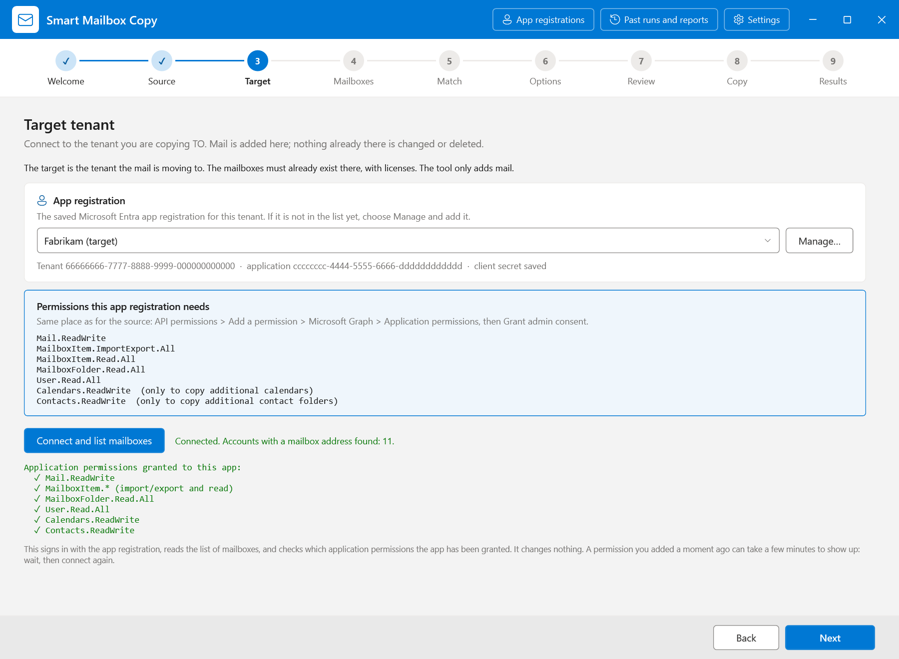

*Step 3 — Target tenant*

Click **Next** to proceed.

### Step 4 — Choose Mailboxes

Every mailbox in the source tenant is listed. Use the filters to narrow the list, then tick the ones to copy.

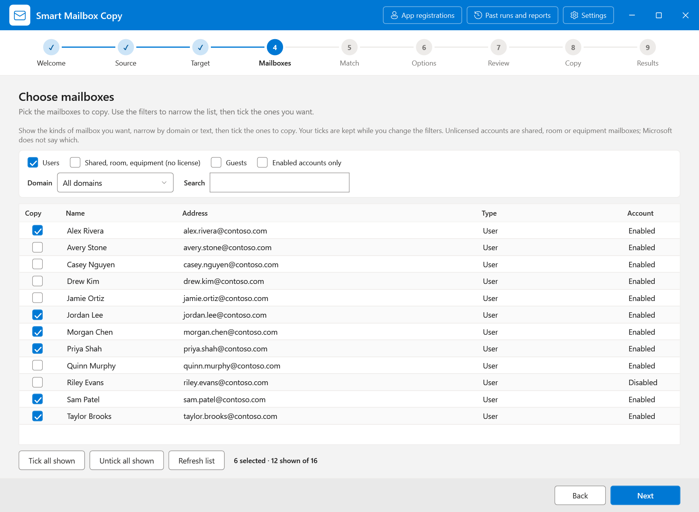

*Step 4 — Choose mailboxes, filtered by kind, domain or text*

| Filter | What it does |
|---|---|
| **Users** | Licensed user accounts (shown by default) |
| **Shared, room, equipment (no license)** | Accounts with no license. Microsoft does not say which kind of resource each is, so they are grouped |
| **Guests** | Guest accounts from other organizations |
| **Enabled accounts only** | Hides disabled accounts |
| **Domain** | Only addresses in one domain |
| **Search** | Names or addresses containing your text |

- Your ticks are kept while you change the filters; the count at the bottom shows how many are selected and how many are hidden by the filters.
- **Tick all shown** and **Untick all shown** act on the filtered list only.

Click **Next** once your selection is complete.

### Step 5 — Match Mailboxes

Each source mailbox needs a target mailbox. The tool matches them by swapping the domain (`alex.rivera@contoso.com` becomes `alex.rivera@fabrikam.com`) and checks each against the target's real mailbox list.

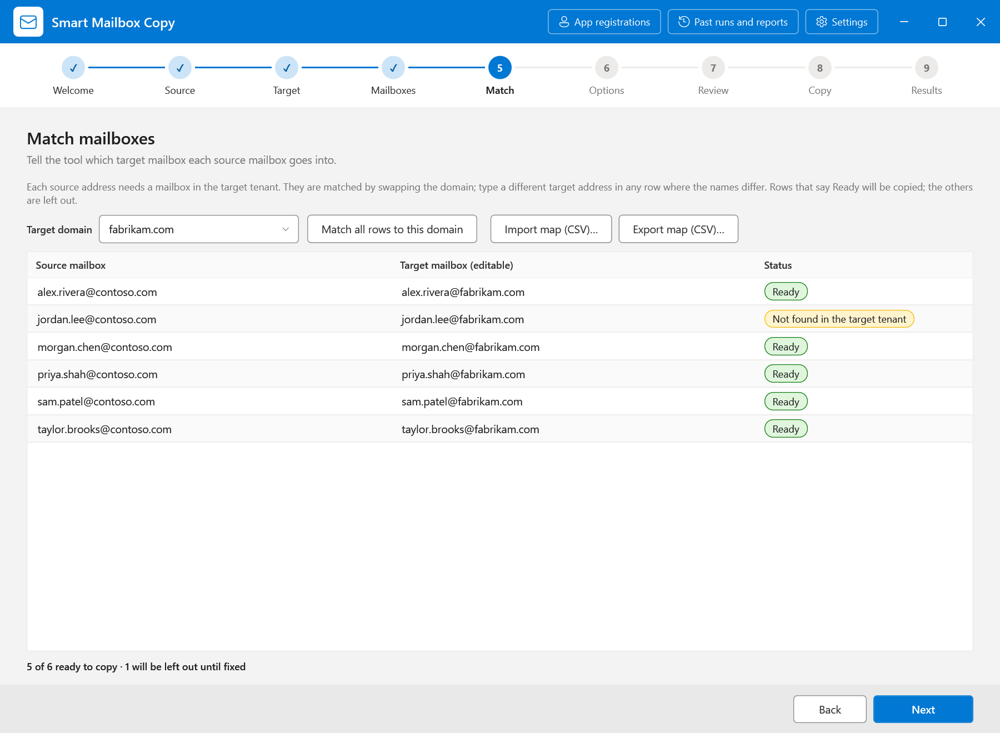

*Step 5 — Match mailboxes, with a row that needs fixing*

- Rows that say **Ready** will be copied. Other rows (for example **Not found in the target tenant**) are left out until you fix them.
- To fix a row, type the correct target address in the **Target mailbox** column.
- Change the **Target domain** and select **Match all rows to this domain** to redo the whole list.
- **Import map** and **Export map** read and write a simple `source,target` CSV file, useful when the names differ in many places.
- Two rows cannot copy into the same target mailbox.

Click **Next** when at least one row is ready.

### Step 6 — Options

This step decides where the mail goes, what else is copied, and whether to copy less.

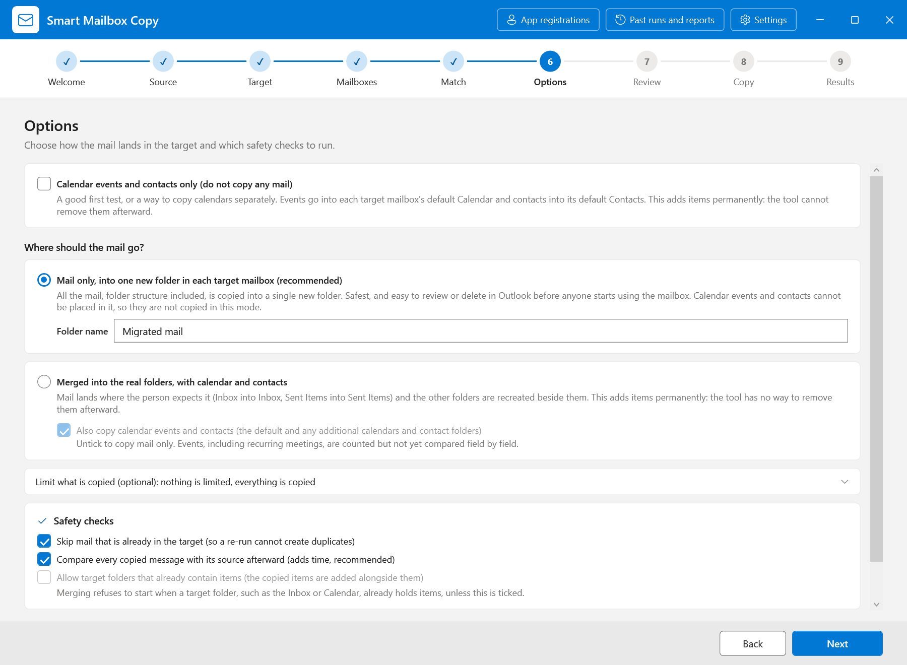

*Step 6 — Options*

**Calendar events and contacts only** (box at the top). Copies no mail at all: only the default Calendar and Contacts and any additional calendars and contact folders. A good first test of calendar copying, or a way to copy calendars separately. See [Calendar Events and Contacts](#calendar-events-and-contacts).

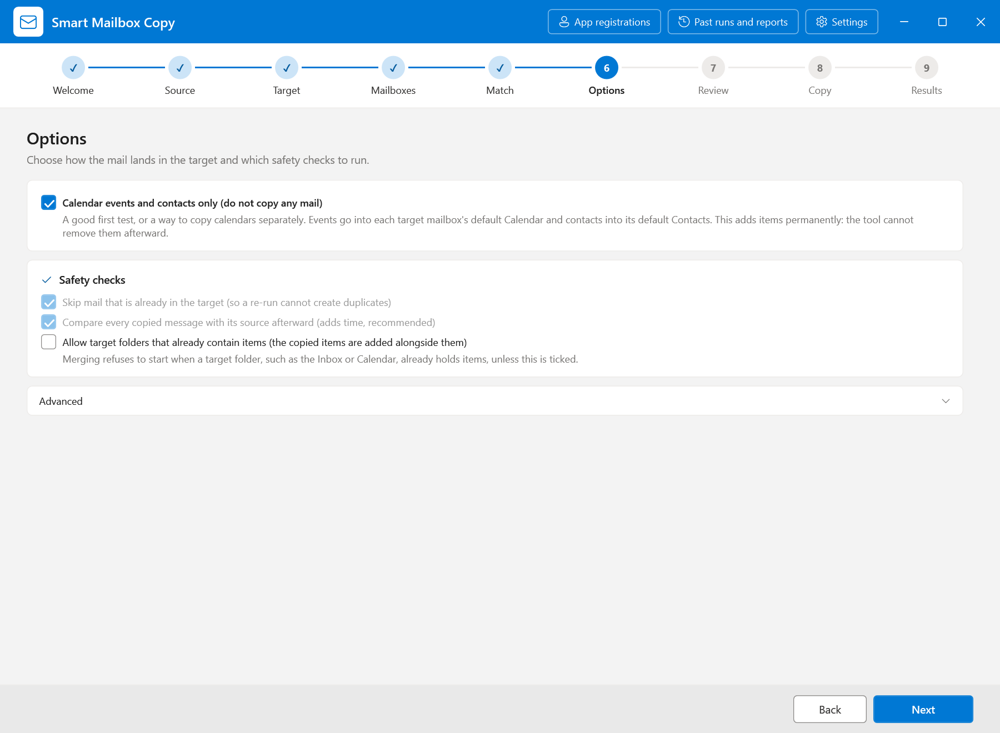

*Step 6 — Options with calendar events and contacts only ticked*

**Where should the mail go?**

- **Mail only, into one new folder** *(recommended)* — everything goes into a single new folder you name, with the folder structure preserved underneath. Easy to review or delete in Outlook. Calendar events and contacts cannot go into this folder, so they are not copied in this mode
- **Merged into the real folders, with calendar and contacts** — mail lands where the person expects it. The box inside this card, ticked by default, also copies calendar events and contacts. Untick it for mail only

**Limit what is copied (optional).** Collapsed by default, because by default everything is copied. Expand it to leave out folders, copy only mail from a date onward, or skip large messages.

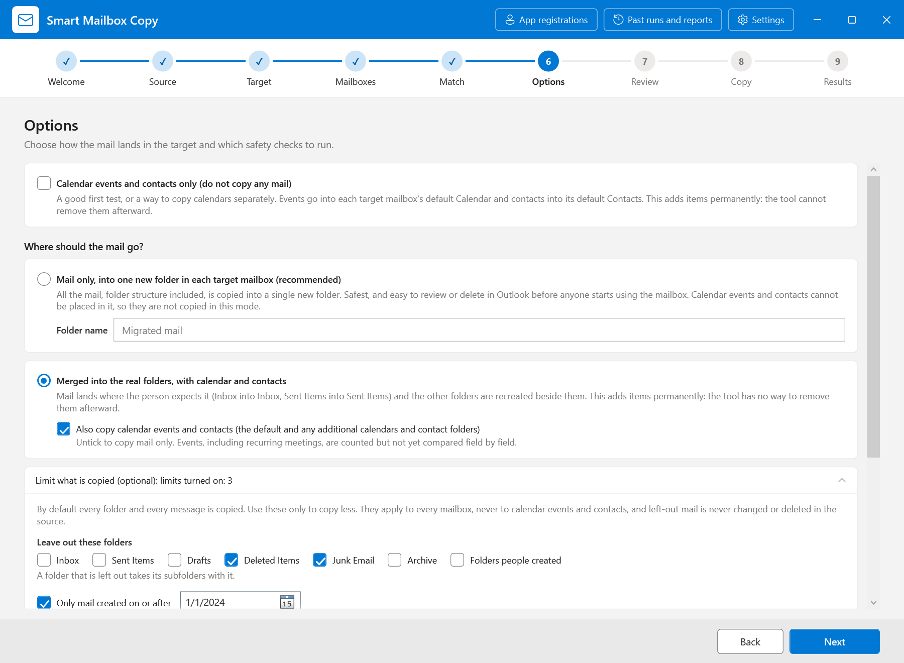

*Step 6 — Options with merge selected and the limits expanded*

**Safety checks:**

- **Skip mail that is already in the target** *(on)* — a re-run cannot create duplicates
- **Compare every copied message with its source afterward** *(on)* — adds time, and is what lets the Results screen say "verified identical"
- **Allow target folders that already contain items** — merging refuses to start when a target folder such as the Inbox already holds items, unless this is ticked

**Advanced:** *Start over* ignores what earlier runs already copied. *Calendars and contact folders to leave out* lists additional calendars or contact folders (by name) that should not be copied, such as a subscribed holiday calendar. *Mailboxes that must never be written to* is a list of addresses the tool will refuse as a target.

Click **Next** to proceed.

### Step 7 — Review

A plain-language summary of the plan, a **size and time estimate**, and any warnings. Nothing has been copied yet.

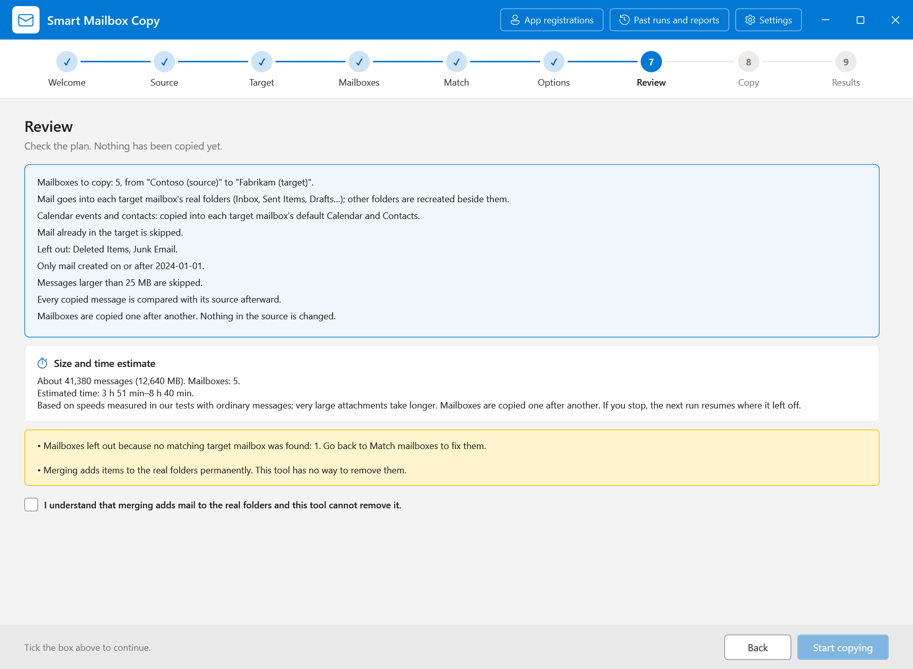

*Step 7 — Review, with the size and time estimate and warnings*

- To make the estimate, the tool reads the size of each selected mailbox (read only; it never contacts the target). **Start copying** becomes available when the estimate finishes, or choose **Skip the estimate**.
- The time is a range, based on speeds measured in tests with ordinary messages. Very large attachments take longer.
- Warnings tell you, for example, how many mailboxes will be left out because no target was found, or that merging adds items permanently.
- If you chose to merge, tick the acknowledgment box.

Click **Start copying** and confirm.

### Step 8 — Copy

An overall progress bar, the time remaining, and a row for each mailbox. Open **Folder detail for the running mailbox** to see each folder's progress, and **Log** for the live log.

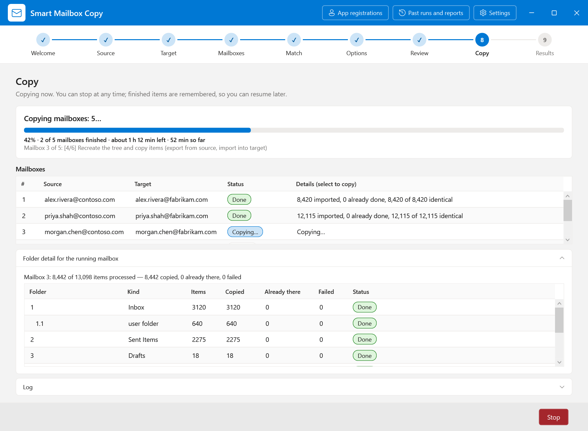

*Step 8 — Copy in progress*

- Mailboxes are copied one after another.
- **Stop** ends the run after the current item. Finished items are remembered, so you can run again later and it continues where it left off.

> **Note:** Do not close the window while a copy is running. Closing stops the copy (you will be asked to confirm).

### Step 9 — Results

When the copy finishes, the Results screen opens.

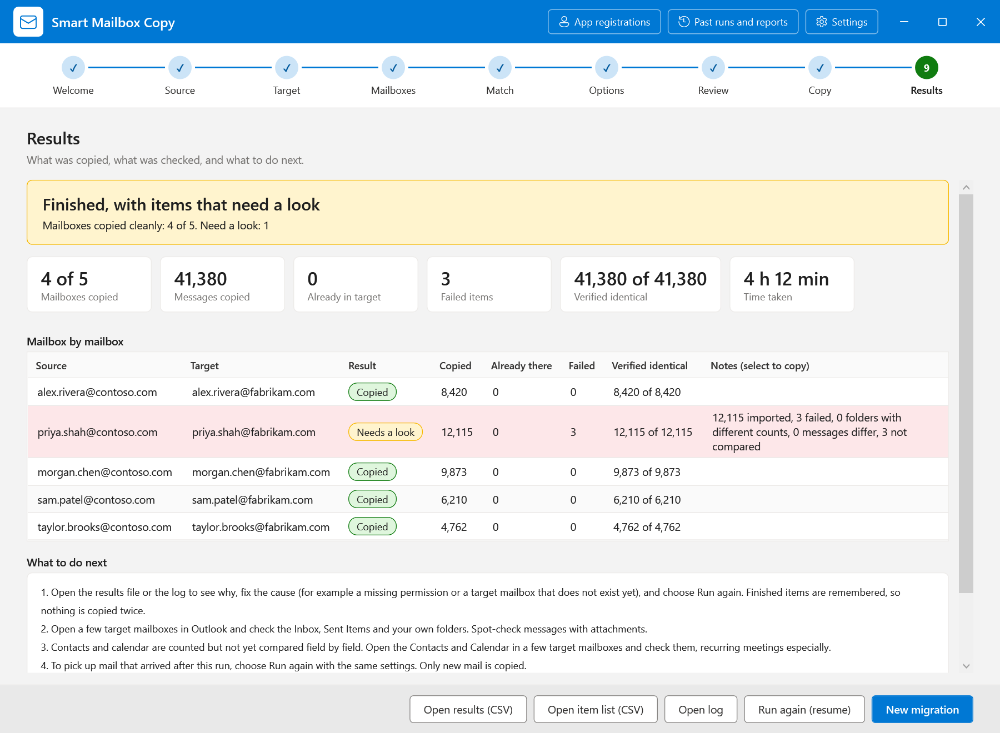

*Step 9 — Results, with one mailbox that needs a look*

- The banner is green (**Copy complete**), amber (**Finished, with items that need a look**) or red (**The copy stopped**).
- The tiles show mailboxes copied, messages copied, already in the target, failed items, messages verified identical, and the time taken.
- **Mailbox by mailbox** lists each mailbox's result with counts. The **Notes** column explains anything that needs a look; select its text to copy it, or select a row and press Ctrl+C.
- **What to do next** gives steps that fit what happened.
- **Copy this summary** puts a plain-text summary on the clipboard. **Open results (CSV)**, **Open item list (CSV)** and **Open log** open the files described in [section 7](#7-results-logs-and-files). **Run again (resume)** returns to the Review step. **New migration** returns to Choose mailboxes.

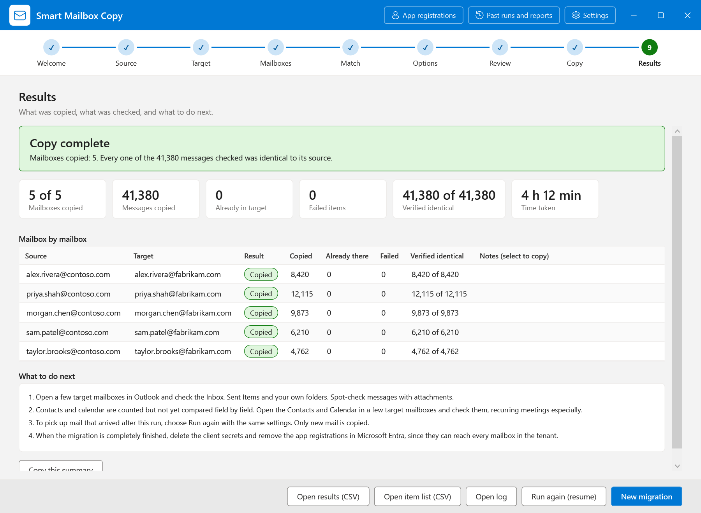

*Step 9 — Results when everything copied and verified cleanly*

---

## 6. Copy Modes — Detailed Reference

### Choosing a Mode

| | New folder | Merged |
|---|---|---|
| Where mail goes | One new folder you name, in each target mailbox | The real Inbox, Sent Items, Drafts, Deleted Items, Junk Email and Archive; other folders are recreated beside them |
| Calendar and contacts | Not copied | Optional (on by default) |
| Existing mail in the target | Untouched (it is a new folder) | Untouched; copied mail is added alongside |
| Undo | Delete the folder in Outlook | Not possible with this tool. Remove items yourself in Outlook |
| Refuses a non-empty target? | No | Yes, unless **Allow target folders that already contain items** is ticked |

Empty system folders (such as Conversation History) are left out. A real folder that has no match in the target is copied as an ordinary folder.

### Filters

Filters never change or delete anything in the source; left-out mail is simply not copied. They apply to every selected mailbox and never to calendar events and contacts.

- **Leave out these folders** — Inbox, Sent Items, Drafts, Deleted Items, Junk Email, Archive, and "folders people created" (their own top-level folders). A folder that is left out takes its subfolders with it
- **Only mail created on or after** a date — this is the day each message was created in the mailbox, which is normally the day it arrived. Check a sample after the first copy. If a message's date cannot be read it is kept, never silently dropped
- **Skip messages larger than** a size in MB

A later run with wider filters only adds what the earlier run left out, because mail already in the target is skipped.

### Calendar Events and Contacts

Events (including recurring meetings) go into each target mailbox's **default Calendar**, and contacts into its **default Contacts**, only in merge mode or with **Calendar events and contacts only**.

A person's **additional calendars and contact folders** are copied too. Each is recreated in the target as a real calendar or contact folder with the same name (a same-named one that already exists is reused, so a re-run does not duplicate it). This needs the `Calendars.ReadWrite` and `Contacts.ReadWrite` application permissions on the target app; without them those folders fail with a message saying so, and the rest of the mailbox still copies.

Calendars you merely subscribe to (such as a holiday calendar) cannot be told apart from normal ones, so they are copied like any other unless you list them under **Advanced → Calendars and contact folders to leave out** (one name per line, exactly as Outlook shows it; on the command line, `--exclude-calendars "Name 1;Name 2"`). The **Birthdays** calendar is never copied, because Outlook builds it from contacts. The default Calendar and Contacts are never affected by the list.

**Tasks, notes and journal folders are not copied**: Graph cannot create those folders in the target.

> **Note:** After your first run, open the Calendar and Contacts of a few target mailboxes and check them, recurring meetings especially. Events keep their original dates, so look at the date they were scheduled for, not today. To confirm a recurring series arrived as one series, open it and look for "this occurrence" or "the series".

> **Important:** Events and contacts are not checked for duplicates. Do not run the same calendar copy twice with *Start over* ticked.

### Duplicate Check and Verification

- **Duplicate check** — before copying a folder, the tool reads the message ids already in the target folder and skips any source message with the same internet message id
- **Verification** — after copying, each message is compared with its source on every field the API exposes (dates, read state, flags, categories, importance, attachments, recipients and more). The one known harmless difference is the "unmodified" flag bit, which clears on import. A mailbox is marked **Needs a look** if any message differs or cannot be paired

---

## 7. Results, Logs and Files

Everything is written under `%LOCALAPPDATA%\SmartMailboxCopy`:

| File | What it holds |
|---|---|
| `logs\run-<time>.log` | The full log, including a line for every request |
| `logs\run-<time>.errors.log` | Warnings and errors only, with details |
| `logs\items-<time>.csv` | One row per item: time, mailbox number, folder position, item id, result (`copied`, `skipped`, `failed`) and detail |
| `reports\batch-<time>.csv` | One row per mailbox with its result. Mailbox numbers match the item list |
| `reports\copy-<time>.md` | A readable summary of the run |
| `journals\` | The resume journal (see [section 8](#8-running-again-and-resuming)) |

The **Past runs and reports** button (bottom left) opens the reports folder. The logs and the item list never contain subjects, sender names, folder names or attachment names, only opaque ids and folder positions such as `3.2`. The item list opens in Excel.

---

## 8. Running Again and Resuming

- **Resume journal** — remembers every item that was copied for each source and target pair. If a run is stopped or interrupted, **Run again (resume)** carries on without copying anything twice
- **Duplicate check** — a second safeguard: even if the journal is lost, mail already in the target is skipped
- **Catching up** — to pick up mail that arrived in the source after a run, run again with the same settings. Only new mail is copied
- **Start over** (Advanced) — ignores the journal. Use it only after you have emptied the target yourself; otherwise the journal would make the tool skip items you deleted

> **Note:** Because the tool cannot delete, resetting a test target is a manual job in Outlook: delete the folders and items the copy added, and tick **Start over** before the next run.

---

## 9. Command Line

`SmartMailboxCopy.exe` (included in the release zip) offers the same engine for scripting. Run it with no arguments for the full list. The main commands:

| Command | Purpose |
|---|---|
| `list-mailboxes --side source\|target --app-only` | List a tenant's mailboxes and print the application permissions the app was granted; with `--map-to-domain <domain> --out map.csv` it also writes a `source,target` map |
| `copy-batch --map map.csv (--target-container <name> \| --merge-wellknown) --app-only` | Copy every mailbox in the map, one after another |
| `copy-tree …` | Copy one mailbox's whole folder tree (interactive sign-in or `--app-only`) |
| `copy …` | Copy one top-level folder into a new folder |

Useful options: `--include-pim`, `--pim-only`, `--no-extra-pim`, `--exclude-calendars`, `--allow-nonempty`, `--no-dedupe`, `--no-verify`, `--fresh`, `--scan` (read-only survey), `--exclude-folders`, `--since`, `--max-item-mb`.

The command line reads its settings from `smartmailboxcopy.config.json` (copy `smartmailboxcopy.config.sample.json` and fill it in; the file is ignored by git because it holds secrets).

---

## 10. Troubleshooting

### "The client secret is not valid" (AADSTS7000215)

You saved the secret's **ID** instead of its **Value**, or it belongs to a different app. Create a new secret and save its Value under **Manage**.

### "The client secret has expired"

Create a new secret and update it under **Manage**.

### "That application (client) ID was not found in this tenant"

The tenant ID and client ID do not belong together. Check both on the registration's Overview page.

### "The app is missing the User.Read.All application permission, or admin consent has not been granted"

Add `User.Read.All` as an **Application** permission and select **Grant admin consent**.

### A ✗ next to a permission on the Source or Target step

That application permission was not granted, or admin consent is missing. Add it under API permissions as an **Application** permission, select **Grant admin consent**, wait a few minutes, and connect again.

### "Access is denied" when the copy starts (HTTP 403)

A needed **Application** permission is missing or not consented. The target needs `Mail.ReadWrite` and the import/export and read permissions in [section 4](#4-setup--entra-app-registration); additional calendars and contact folders also need `Calendars.ReadWrite` and `Contacts.ReadWrite`. New permissions can take a few minutes to apply.

### "Not found in the target tenant" in the Match step

The target mailbox does not exist or has no mailbox address yet. Create or license it, then reconnect on the Target step to reload the list, or type the right address.

### "These target folders already hold mail"

Merging into a non-empty folder is refused by default. Tick **Allow target folders that already contain items** if that is what you want.

### A re-run copies nothing

The journal or the duplicate check found everything already copied. That is the intended behavior. If you emptied the target on purpose, tick **Start over**.

### "HTTP 429 / waiting, then retrying" in the log

Microsoft is throttling. The tool waits and retries automatically; large copies may simply take longer.

### A mailbox shows "Needs a look"

Open **Notes** on the Results screen and the item list for the failed item ids. Fix the cause and run again; finished items are not copied twice.

### The wizard asks to confirm before closing

A copy is running. Closing stops it, but it can be resumed.

### Getting Help

If something fails and the message is not clear, open the errors log (`run-<time>.errors.log`). It has the details without any mail content, so it is safe to share when asking for help. Please [report issues](https://github.com/sregan1/Smart-Mailbox-Copy/issues) there.

---

## 11. Test Results

**Run live against real tenants, with synthetic mail:**

- Copying one folder, and a whole folder tree, within a tenant and across tenants: every message identical on every compared field.
- Merging into the real folders (interactive sign-in): identical on every compared field, existing mail untouched.
- The wizard, which the author has run repeatedly against test tenants.
- A shared mailbox as the source: its 35 messages (13 folders) were copied into a user mailbox in another tenant, identical on every compared field.
- A batch of two mailboxes, a test user and a shared mailbox, copied one after another into a user mailbox and a shared mailbox in another tenant: 549 messages, all identical on every compared field, no failures.
- App-only access, with no signed-in user (application permissions only; every delegated permission removed from the apps): listing mailboxes in both tenants, and a one-mailbox copy of 495 messages in 4.7 minutes, identical on every compared field, with no throttling.
- Calendar events and contacts, counts only: 107 items copied into the default Calendar and Contacts and into additional calendars and contact folders (one nested), with no failures, matching counts, and a clean resume.

**Not supported:** in-place archive mailboxes, group mailboxes and public folders (not in Microsoft's general release of the API yet), tasks, notes and journal folders, and the Exchange settings listed in [section 12](#12-other-things-to-migrate). Shared, room and equipment mailboxes: mail from a shared mailbox, as the source and as the target, is proven; the default calendar should copy the same way as a user's (untested); booking policies and other resource settings are not copied.

> **Note:** Do a small trial first (one mailbox, into a new folder) and check the result in Outlook before you copy at scale.

---

## 12. Other Things to Migrate

Smart Mailbox Copy copies mailbox *items*. Some things people expect in a migration are Exchange *settings* or other kinds of mailbox, which the import/export API does not cover. Plan to move them separately. The commands below are starting points; check them against Microsoft's current documentation and try them on a test mailbox first.

| What | Why it is not copied | How to move it |
|---|---|---|
| **In-place archive mailboxes** | Microsoft's general release of the API does not include archive mailboxes; it announced archive access as coming. | Check the [announcement](https://devblogs.microsoft.com/microsoft365dev/announcing-general-availability-of-the-mailbox-import-and-export-microsoft-graph-apis/) for current status. Until then, move archive contents with another tool, or ask people to keep what they need in the primary mailbox. |
| **Mailbox permissions** (Full Access) | Exchange setting, not an item | Read in the source: `Get-MailboxPermission -Identity <user>`. Recreate in the target: `Add-MailboxPermission -Identity <user> -User <delegate> -AccessRights FullAccess -AutoMapping $true` |
| **Send As and Send on behalf** | Exchange setting | `Get-RecipientPermission -Identity <user>` then `Add-RecipientPermission -Identity <user> -Trustee <delegate> -AccessRights SendAs`; and `Set-Mailbox -Identity <user> -GrantSendOnBehalfTo <delegate>` |
| **Calendar sharing permissions** | Exchange setting | `Get-MailboxFolderPermission -Identity "<user>:\Calendar"` then `Add-MailboxFolderPermission` in the target |
| **Mail rules** | Exchange setting that points at folders and addresses of the source tenant | List them with `Get-InboxRule -Mailbox <user>` and recreate the ones that still make sense with `New-InboxRule`. Review each: a rule can forward or delete mail |
| **Room and equipment settings** (booking policy, capacity, delegates) | Exchange setting | `Get-CalendarProcessing -Identity <room> \| Format-List` in the source, then `Set-CalendarProcessing` and `Set-Place` in the target |
| **Microsoft 365 Groups and Teams** | Group mailboxes are not in the general release of the API | Use a tool for groups and Teams. The group's SharePoint site content can be copied with a SharePoint copy tool |
| **Public folders** | Not in the general release of the API | Use Microsoft's public folder migration, or a dedicated tool |
| **Tasks, notes, journal** | Graph cannot create those folders | Export from Outlook to a file and import in the target, if people need them |

Keep a short record of which of these you have moved for each mailbox, and tell people to check their rules and delegates the first day after the cutover.
